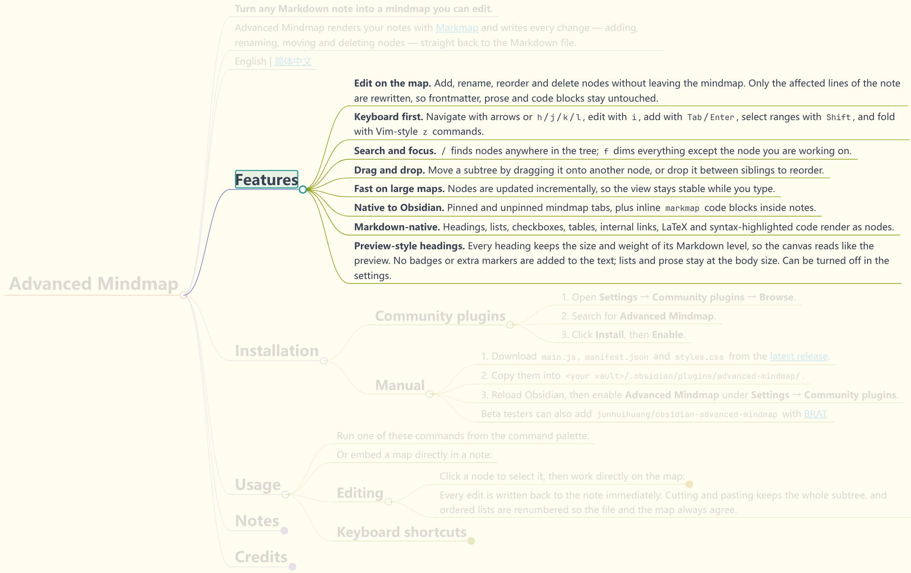

# Advanced Mindmap

**把任意 Markdown 笔记变成可编辑的思维导图。**

Advanced Mindmap 使用 [Markmap](https://markmap.js.org/) 渲染笔记，并把你做的每一次修改——新增、重命名、移动、删除节点——直接写回 Markdown 文件。

[English](README.md) | 简体中文



## 功能

- **直接在图上编辑。** 不用离开思维导图就能新增、重命名、调整顺序和删除节点。只重写受影响的那几行，frontmatter、正文和代码块保持原样。
- **键盘优先。** 用方向键或 `h`/`j`/`k`/`l` 移动，`i` 编辑，`Tab`/`Enter` 新增，`Shift` 选择范围，Vim 风格的 `z` 命令折叠。
- **搜索与聚焦。** `/` 在全树中搜索节点；`f` 淡化其他内容，只留下当前分支。
- **拖拽调整。** 把子树拖到另一个节点上即可移动，拖到两个兄弟节点之间即可调整顺序。
- **大图依然流畅。** 节点增量更新，输入时视图保持稳定。
- **原生融入 Obsidian。** 支持固定/跟随笔记的思维导图标签页，也支持在笔记内嵌 `markmap` 代码块。
- **完整的 Markdown 支持。** 标题、列表、复选框、表格、内部链接、LaTeX 和语法高亮代码都能显示为节点。
- **标题与预览一致。** 每个标题使用它所在层级的字号和粗细，画布读起来和同一篇笔记的预览一致。不给节点文字加任何标记或圆点，列表和正文保持正文字号。点击「适应窗口大小」左边的按钮，可以让当前这张图的标题全部回到正文字号，适合节点很多的图。

## 安装

### 社区插件市场

1. 打开 **设置 → 第三方插件 → 浏览**。
2. 搜索 **Advanced Mindmap**。
3. 点击 **安装**，然后 **启用**。

### 手动安装

1. 从 [最新 Release](https://github.com/junhuihuang/obsidian-advanced-mindmap/releases/latest) 下载 `main.js`、`manifest.json` 和 `styles.css`。
2. 复制到 `<你的库>/.obsidian/plugins/advanced-mindmap/`。
3. 重启 Obsidian，在 **设置 → 第三方插件** 中启用 **Advanced Mindmap**。

也可以使用 [BRAT](https://github.com/TfTHacker/obsidian42-brat) 添加 `junhuihuang/obsidian-advanced-mindmap` 进行尝鲜。

## 使用

在命令面板中运行：

- **Advanced Mindmap: 打开‘固定模式’思维导图** — 与单篇笔记绑定的思维导图。
- **Advanced Mindmap: 打开‘非固定模式’思维导图** — 跟随你最后打开的笔记。

也可以直接在笔记中内嵌：

````markdown
```markmap
# 项目
## 目标
- 发布 1.0
- 完成文档
```
````

### 编辑

点击节点选中，然后直接在图上操作：

- **Shift + 点击** 另一个节点可选择两者之间的所有节点；在空白处拖拽可框选。
- **拖拽** 节点到另一个节点上即可移动；拖到两个兄弟节点之间即可调整顺序。
- **拖拽选中节点的右边缘**，或按 **`Ctrl+Shift`** **`+`** / **`-`**，可以加宽 / 收窄该节点。
- 按 **`i`** 重命名，**`Tab`** 新增子节点，**`Enter`** 新增同级节点。
- **右键** 节点可在菜单中选择相同操作。
- **`Backspace`** 删除选中节点，**`Ctrl+Z`** / **`Ctrl+U`** 撤销 / 重做。

每次编辑都会立即写回笔记。剪切和粘贴会保留整棵子树，有序列表会自动重新编号，让文件和导图始终一致。

### 快捷键

| 按键 | 操作 |
| --- | --- |
| 方向键或 `h` `j` `k` `l` | 移动选中节点 |
| `Shift` + 移动 | 从锚点扩展选择范围 |
| `i` | 编辑选中节点 |
| `Tab` / `Enter` | 新增子节点 / 同级节点 |
| `Backspace` / `Delete` | 删除选中节点 |
| `J` / `K` | 在兄弟节点中下移 / 上移选中节点 |
| `Ctrl+X` / `Ctrl+V` | 剪切 / 粘贴节点 |
| `Ctrl+Z` / `Ctrl+U` | 撤销 / 重做 |
| `f` / `F` | 聚焦选中节点 / 其兄弟节点 |
| `Shift+M` | 将选中子树居中 |
| `Shift` `+` / `-` | 放大 / 缩小（按住可连续缩放） |
| `Ctrl+Shift` `+` / `-` | 加宽 / 收窄选中节点 |
| `z` `c` / `z` `o` | 折叠 / 展开一层 |
| `z` `C` / `z` `O` | 折叠子树一层 / 展开全部 |
| `z` `a` | 全部折叠 / 全部展开 |
| `z` `0`…`9` | 整张图只显示指定层数（`z0` 只留根节点） |
| `/`，然后 `n` / `p` | 搜索节点，跳到下一个 / 上一个匹配 |
| `Escape` | 取消选择或关闭搜索 |
| `?` | 显示全部快捷键 |

在导图上随时按 `?` 可以查看完整快捷键面板。

## 注意

Advanced Mindmap 会直接写入你的 Markdown 笔记。它只重写你编辑的节点所对应的那几行，而且导图打开时可以用 `Ctrl+Z` 撤销。即便如此，在编辑大型或重要导图前，仍建议做好备份或使用 Git、Obsidian Sync 等版本管理。

## 致谢

Advanced Mindmap 基于 [Markmap](https://markmap.js.org/) 构建，是 James Tindal 的 [Mindmap NextGen](https://github.com/james-tindal/obsidian-mindmap-nextgen) 的独立分支，而后者源自 James Lynch 的 [obsidian-mind-map](https://github.com/lynchjames/obsidian-mind-map)。

本项目采用 [MIT 许可证](LICENSE)。
